<a href="https://abdelkaderbarhoumi21.github.io/portfolio/">
  
</a>


  

<picture>
  <source media="(prefers-color-scheme: dark)" srcset="assets/sec-about-dark.svg" />
  
</picture>

I'm a Mobile Software Engineer based in **Tunis**, leading the mobile department at **Oxton Digital** — where I oversee Flutter and native Android delivery across client projects. My background is in embedded systems and mechatronics, which is why I enjoy the hard edges of mobile: **BLE & Wi-Fi device links, offline-first sync, real-time chat and payment flows** that simply work.

**Right now** — leading delivery on **Sparta Coaching** · migrating a legacy Android app from XML + Java to **Kotlin + Jetpack Compose** · learning **Kotlin Multiplatform** · open to relocation to **Canada** and the **UAE**.

 

<picture>
  <source media="(prefers-color-scheme: dark)" srcset="assets/sec-work-dark.svg" />
  
</picture>

  <a href="https://abdelkaderbarhoumi21.github.io/portfolio/#work"></a>
  <a href="https://abdelkaderbarhoumi21.github.io/portfolio/#work"></a>

  <a href="https://abdelkaderbarhoumi21.github.io/portfolio/#work"></a>
  <a href="https://abdelkaderbarhoumi21.github.io/portfolio/#work"></a>

  <a href="https://abdelkaderbarhoumi21.github.io/portfolio/#work"></a>
  <a href="https://abdelkaderbarhoumi21.github.io/portfolio/"></a>

 

<picture>
  <source media="(prefers-color-scheme: dark)" srcset="assets/sec-oss-dark.svg" />
  
</picture>

| Project | What it is | Stack |
| :-- | :-- | :-- |
| [**Dukkan**](https://github.com/AbdelkaderBarhoumi21/Android-Dukkan-App) | Native Android B2C e-commerce — browsing to checkout and delivery tracking | Kotlin · Jetpack Compose |
| [**Task API**](https://github.com/AbdelkaderBarhoumi21/Rust_Task_API_Flutter_App) | Production-ready REST service with priorities, statuses and migrations, plus a Flutter client | Rust · Axum · SQLx · PostgreSQL · Flutter |
| [**Hadaf**](https://github.com/AbdelkaderBarhoumi21/Hadaf) | Live football scores, fixtures & stats | Flutter |
| [**Forecast MVVM**](https://github.com/AbdelkaderBarhoumi21/Android-Forecast-MVVM) | Weather app with a dual XML + Compose UI | Kotlin · Room/KSP · Jetpack Navigation |
| [**GetStream Chat**](https://github.com/AbdelkaderBarhoumi21/Flutter-Chat-App-Getstream-io) | Real-time chat built on GetStream.io | Flutter · GetStream.io |

 

<picture>
  <source media="(prefers-color-scheme: dark)" srcset="assets/sec-experience-dark.svg" />
  
</picture>


  

<picture>
  <source media="(prefers-color-scheme: dark)" srcset="assets/sec-toolkit-dark.svg" />
  
</picture>

  


  

<picture>
  <source media="(prefers-color-scheme: dark)" srcset="assets/sec-education-dark.svg" />
  
</picture>

| Degree | School | Years |
| :-- | :-- | --: |
| **Engineering Degree** — Embedded Systems & Mobile Development | Polytech International, Tunis | 2022&nbsp;–&nbsp;2025 |
| **Master** — Mechatronics | ISET Radès | 2022&nbsp;–&nbsp;2024 |
| **Bachelor** — Industrial Electrical Engineering | ISET Radès | 2019&nbsp;–&nbsp;2022 |

<b>Certifications (11)</b>

 

- Claude Code in Action — Anthropic · Jan 2026
- CI/CD with Jenkins and Docker — Udemy · Sep 2025
- The Complete MongoDB Developers Course — Udemy · Sep 2025
- NodeJS Projects Bootcamp 2025 — Udemy · Aug 2025
- PostgreSQL Bootcamp: Beginner to Advanced — Udemy · Aug 2025
- Rust Programming Bootcamp — Udemy · Jul 2025
- Data Structures and OOP with C++ — Udemy · Jul 2025
- Flutter & Firebase Chat App — Udemy · Jun 2025
- Dart & Flutter: Complete Development Course — Udemy · May 2025
- IELTS B2 — British Council
- DELF B2 — Institut Français de Tunis

 

<a href="mailto:abdelkaderbarhoumi21@gmail.com">
  
</a>

  &nbsp;
  &nbsp;
  

